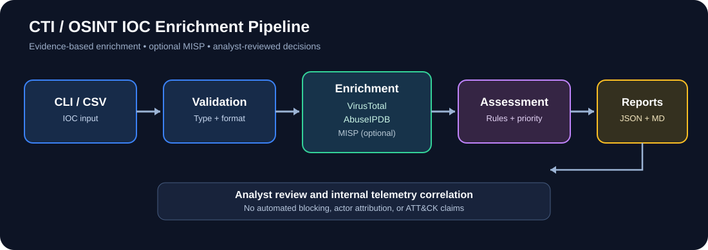

# CTI / OSINT IOC Enrichment Pipeline

A defensive Python portfolio project for cyber threat intelligence collection, enrichment, prioritization, and reporting. It supports IPv4/IPv6, domains, HTTP(S) URLs, and MD5/SHA1/SHA256 hashes.

**Sources:** VirusTotal, AbuseIPDB (IP only), optional MISP. **Outputs:** machine-readable JSON and analyst-readable Markdown reports.

## Pipeline architecture



The diagram shows the implemented workflow. MISP is optional and requires an authorized server; the pipeline does not perform automatic threat actor attribution.

## Example investigation and reports

- [End-to-end investigation: 8.8.8.8](docs/investigation-example.md) — an actual public DNS IP enrichment test, not a simulated malicious incident.
- [Sanitized JSON output](examples/sample-report.json) — generated from a successful live test, with no credentials.
- [Sanitized Markdown report](examples/sample-report.md) — analyst-readable output.

**Note:** A no-detection result is not proof that an indicator is safe. Reputation data is only one input to an investigation.

## Quick start

Requires Python 3.10+.

```bash
python -m venv .venv
# Windows: .venv\Scripts\activate
# macOS/Linux: source .venv/bin/activate
pip install -r requirements.txt
cp .env.example .env   # Windows PowerShell: Copy-Item .env.example .env
# Add your own API keys to .env; never commit .env
python -m cti_pipeline --ioc 8.8.8.8 --type ip
python -m cti_pipeline --file examples/sample_iocs.csv
pytest -q
```

Without configured API keys, the pipeline still runs and correctly marks findings **unknown** rather than clean. To get real enrichment results, configure `VT_API_KEY`, `ABUSE_API_KEY`, and optionally `MISP_URL`, `MISP_API_KEY`, and `MISP_CA_BUNDLE` (trusted CA bundle path for private certificates).

## Verdict model

This is an intentionally transparent **prototype heuristic**:

- VirusTotal: 3+ malicious engine detections → malicious; 1–2 malicious or 2+ suspicious → suspicious; otherwise no detection.
- AbuseIPDB: score ≥75 → malicious; ≥25 → suspicious; otherwise no detection.
- MISP: matching attribute → known indicator; no match → no detection. A MISP match alone does not establish attribution or maliciousness.
- Aggregation: any malicious/known indicator → high priority; otherwise suspicious → medium; otherwise no detection → low. If all sources fail or are unconfigured → unknown/review.

These are not calibrated probabilities. **No detection does not mean safe**, and priority is not a replacement for business impact assessment. Verify indicator relevance, freshness, source reliability, and internal telemetry before blocking.

## Safety and limitations

- The tool makes reputation lookups only. It does not visit submitted URLs, run malware, crawl dark web content, or scan remote hosts.
- Sending indicators to third-party services can disclose investigation details. Use only approved, non-sensitive indicators.
- MISP searches require a functioning authorized MISP server; integration is not proven merely by configuration.
- Current implementation is sequential and does not implement a persistent quota scheduler, deduplication, automatic ATT&CK mapping, threat actor attribution, or LLM analysis.
- Source timestamps and contextual risk should be validated by an analyst. API quotas vary by account and must be respected.
- Reports are prototypes for analyst review, not verified intelligence products.

## Testing

`pytest -q` runs offline unit tests using mocked source responses. See `docs/methodology.md` for known limitations and extension ideas.

## Future improvements

Persistent per-provider rate limiting, source-specific caching, richer MISP event context, STIX/TAXII interoperability, internal telemetry correlation, documented benchmark datasets, human-reviewed AI summaries, and evidence-based MITRE ATT&CK mapping.

## License

MIT. See LICENSE.
